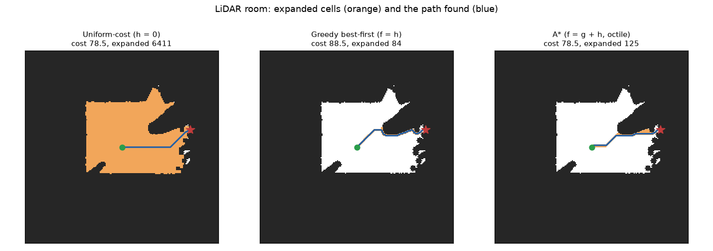
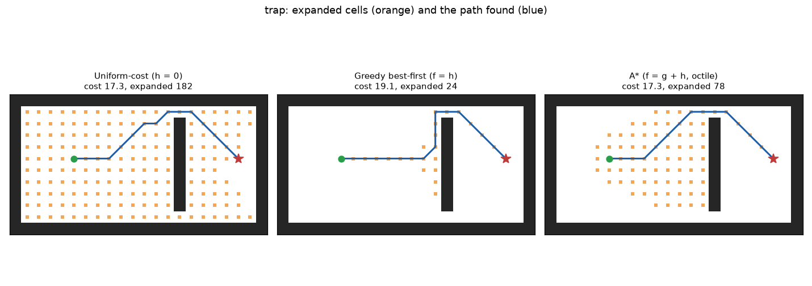
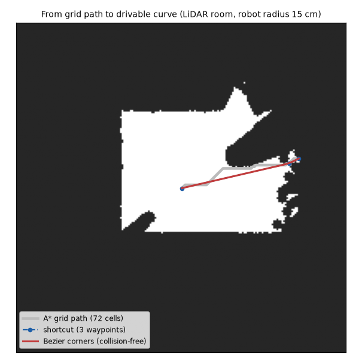

# A* Path Planning for a LiDAR Model Car

[](https://github.com/HannaBeshoy/astar-path-planning/actions/workflows/ci.yml)

**Foundations of Artificial Intelligence course project** · University of Debrecen, Faculty of Informatics · Python, NumPy, Matplotlib · **78 tests in CI; runs on a map built from a LiDAR scan**

A small autonomous car with a 2D LiDAR has to find its way across a room. This project turns one LiDAR scan into a map, formulates path finding as a **search problem**, and compares the search algorithms of the course on it: breadth-first, depth-first, uniform-cost, greedy best-first, A* with three heuristics, and weighted A*. The best path is then shortened and rounded into a curve the car can drive.

- [x] State space from a real scan format: the scan of the [LiDAR Scan Filtering](https://github.com/HannaBeshoy/lidar-scan-filtering) project, cleaned with the median-5 filter chosen there, turned into an occupancy grid, obstacles grown by the robot's radius (configuration space)
- [x] Seven algorithms on one generic best-first loop, compared on five maps: cost, nodes expanded, memory, time
- [x] Heuristics checked, not assumed: octile and Euclidean are proved **admissible and consistent** against exact costs; Manhattan is shown to overestimate with diagonal moves, and A* with it returns longer paths
- [x] Every optimal algorithm matches an independent Dijkstra on 30 random maps; weighted A* stays within 2× the optimum
- [x] Path smoothing: line-of-sight shortcuts and Bézier corners (from the [Bézier Path Planning](https://github.com/HannaBeshoy/bezier-path-planning) project), checked collision-free



## The result

On the room seen by the LiDAR (200 × 200 cells of 5 cm, robot radius 15 cm):

| Algorithm | Path cost (cells) | vs. optimal | Nodes expanded |
| --- | --- | --- | --- |
| Breadth-first | 78.46 | optimal here | 6,404 |
| Depth-first | 489.49 | +524 % | 388 |
| Uniform-cost (Dijkstra) | 78.46 | optimal | 6,411 |
| Greedy best-first | 88.50 | +12.8 % | **84** |
| A* (Euclidean) | 78.46 | optimal | 1,118 |
| **A* (octile)** | **78.46** | **optimal** | **125** |
| Weighted A* (w = 2) | 86.74 | +10.6 % | 98 |

**A* with the octile heuristic finds the same shortest path as uniform-cost search while expanding 51 times fewer cells.** Greedy best-first is even faster but takes a 13 % longer route. The heuristic matters as much as the algorithm: the Euclidean distance is also admissible but less informed, so A* with it expands 9 times more cells.

All maps (maze, warehouse, a trap for greedy search, random obstacles, LiDAR room) are in [results/compare.md](results/compare.md).



## The search problem

| Part | Here |
| --- | --- |
| State | a free cell (row, column) of the occupancy grid |
| Initial state | the cell of the LiDAR (the car) |
| Actions | 8 moves; a diagonal move may not cut a blocked corner |
| Step cost | 1 straight, √2 diagonal |
| Goal test | the target cell |
| Heuristic h(n) | octile distance: the exact cost if there were no obstacles |

| Algorithm | Frontier ordered by | Optimal? |
| --- | --- | --- |
| Breadth-first | depth (FIFO) | only when all steps cost the same |
| Depth-first | newest first (LIFO) | no |
| Uniform-cost | g(n) | yes |
| Greedy best-first | h(n) | no |
| A* | g(n) + h(n) | yes, with an admissible h |
| Weighted A* | g(n) + w·h(n) | within w × optimal |

## From grid path to driving



The 72-cell grid path zig-zags. Line-of-sight shortcuts reduce it to 3 waypoints, and quadratic Bézier corners make the turns smooth; every segment is checked against the inflated map.

## Course core vs extensions

| Course topic (Foundations of AI) | Where |
| --- | --- |
| problem formulation: states, actions, costs, goal test | `planner/grid.py` |
| uninformed search: BFS, DFS, uniform-cost | `planner/search.py` |
| informed search: greedy, A*, admissibility, consistency | `planner/search.py`, `planner/heuristics.py`, `tests/test_search.py` |
| comparing algorithms: completeness, optimality, time, memory | `compare.py`, `results/compare.md` |
| **Extensions:** occupancy grid from LiDAR, configuration space, weighted A*, path smoothing | `planner/grid.py`, `planner/smooth.py` |

## Running it

```bash
python -m venv .venv && source .venv/bin/activate      # Windows: .venv\Scripts\activate
pip install -r requirements.txt
python compare.py                                        # tables + figures (results/, docs/img/)
python -m pytest -q                                      # 78 tests
```

To use your own scan, save it as `data/example_scan.csv` (`angle_deg,range_m`, one full turn; millimetres are converted).

## Repository layout

```text
planner/grid.py         occupancy grid, LiDAR scan -> grid, median-5 filter, inflation
planner/search.py       BFS, DFS, uniform-cost, greedy, A*, weighted A* (one best-first loop)
planner/heuristics.py   zero, Manhattan, Euclidean, octile
planner/smooth.py       Bresenham line of sight, shortcuts, Bezier corners
planner/maps.py         maze, warehouse, trap, random, LiDAR room
compare.py              comparison table and figures
data/example_scan.csv   simulated scan from lidar-scan-filtering
tests/test_search.py    78 tests
docs/PROJECT_GUIDE.md   how each algorithm works, how to explain it, next steps
```

## Author

Beshoy Hanna · Computer Science Engineering BSc, University of Debrecen · [GitHub](https://github.com/HannaBeshoy) · [LinkedIn](https://linkedin.com/in/beshoy-hanna-8b52213a0)
